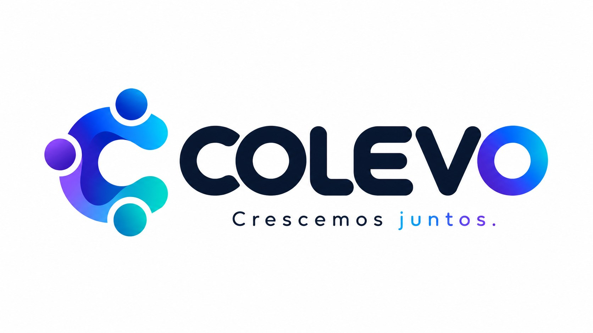
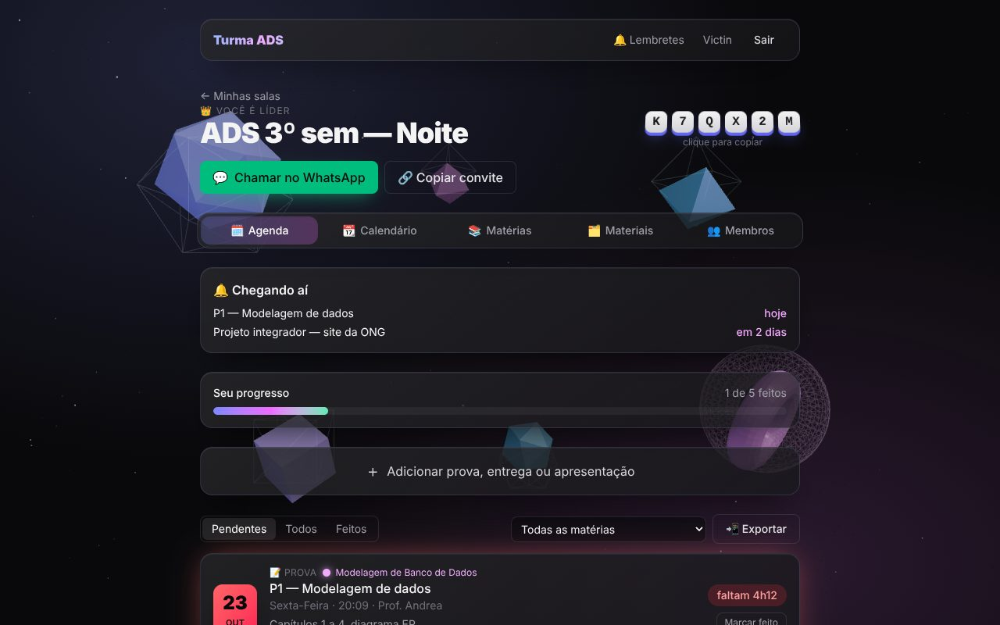
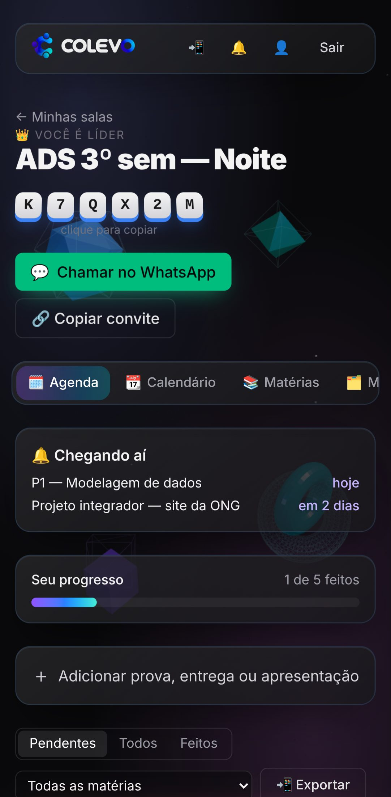
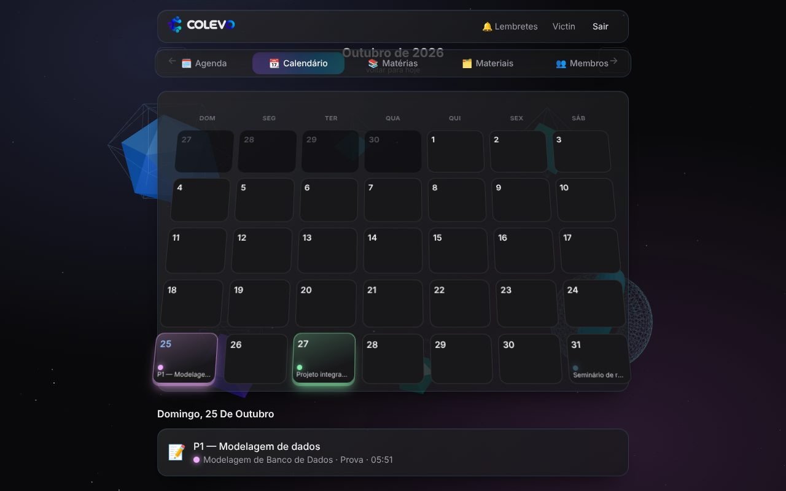
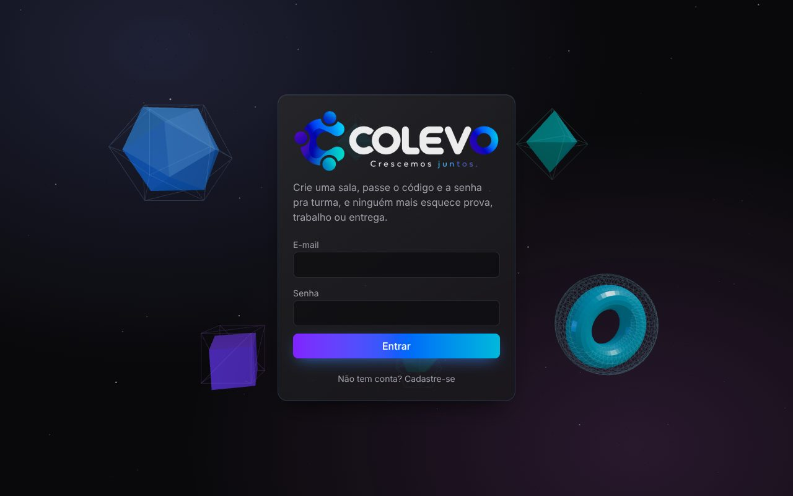

<p align="center">
  
</p>

**Colevo** (**co**letivo + **evo**lução) é a turma organizada junto. Funciona como as salas do Among Us: alguém cria uma sala, passa o **código** e a **senha**, e todo mundo passa a ver as mesmas provas, entregas, matérias e materiais, com **lembretes** antes de cada prazo. Serve para estudantes de qualquer curso.

**👉 [Abrir o Colevo](https://victin7.github.io/Colevo/)** · feito por [Victor Anjos](https://linkedin.com/in/victor-s-anjos), estudante de Análise e Desenvolvimento de Sistemas na UNICID

<p align="center">
  
  
</p>

## O que dá para fazer

| | |
|---|---|
| 🚪 **Salas com código + senha** | Quem cria vira **líder**; os colegas entram com o código de 6 letras e a senha. O link de convite já abre com o código preenchido. |
| 💬 **Convite pelo WhatsApp** | Um botão monta a mensagem com código, senha e link. |
| 🗓️ **Agenda** | Provas, entregas e apresentações por urgência, com **contagem regressiva ao vivo** ("faltam 4h12"). |
| ✓ **Já fiz** | Cada aluno marca o que já fez e acompanha uma barra de progresso. |
| 📆 **Calendário 3D** | O mês inclinado como uma mesa; os dias com prova "sobem" com a cor da matéria. |
| 📚 **Matérias** | Nome, professor e cor, que aparece nos cards e no calendário. |
| 🗂️ **Materiais** | Links, PDFs/imagens e anotações por matéria, com curtidas (o melhor resumo sobe para o topo). |
| 🔔 **Lembretes** | E-mail diário, notificação do sistema e exportação para o Google Agenda ou `.ics`. |
| 👑 **Painel do líder** | Remover aluno, passar a liderança, trocar a senha, gerar um novo código e excluir a sala. |
| ⚡ **Tempo real** | Quando alguém adiciona uma prova, aparece na hora para toda a sala. |
| 📲 **Instalável** | É um PWA: vira ícone na tela inicial e abre em tela cheia. |

<p align="center">
  
  
</p>

## Stack

| Camada | Tecnologia |
|---|---|
| Front | React 19, TypeScript, Vite, Tailwind CSS 4 |
| Rotas e dados | TanStack Router (hash history) e TanStack Query (cache e atualização otimista) |
| 3D | Three.js com React Three Fiber (carregado sob demanda) e CSS 3D transforms |
| Backend | Supabase: Postgres, Auth, Storage, Realtime e Edge Functions (Deno) |
| Agendamento | `pg_cron` e `pg_net` chamando a Edge Function de lembretes todo dia às 8h |
| Testes | Vitest (lógica) e Playwright (ponta a ponta, desktop e celular) |
| Deploy | GitHub Actions → GitHub Pages; só publica se todos os testes passarem |

## Segurança

A regra fica **no banco**, não só na tela:

- **Row Level Security** em todas as tabelas: quem não é membro de uma sala não vê nada dela, nem pela API.
- **Senha da sala com bcrypt** (`pgcrypto`), guardada numa tabela fora da API. Nem o líder consegue ler o hash.
- **Limite de tentativas:** 8 erros em 10 minutos bloqueiam novas tentativas (contra quem tenta adivinhar a senha). A mensagem de erro não diz se errou o código ou a senha.
- **Ações de líder** (remover, trocar senha, excluir) em funções `security definer` que conferem o papel de quem chama.
- **Arquivos no Storage** com links temporários (1h) e pastas por sala.
- **Lembretes:** a Edge Function só roda com um segredo gerado e guardado no próprio banco.

Isso foi testado no banco real simulando quatro usuários (líder, colega, alguém com a senha errada e um intruso), dentro de transações desfeitas no final.

```
salas ─┬─ sala_membros ── perfis ── preferencias_lembrete
       ├─ materias ─┬─ materiais ── materiais_curtidas
       └─ eventos ──┴─ eventos_concluidos
```

O schema está em [`supabase/migrations/`](supabase/migrations/) e a função de lembretes em [`supabase/functions/`](supabase/functions/).

## Rodando localmente

```bash
npm install
cp .env.example .env.local   # URL e chave pública do Supabase
npm run dev
```

```bash
npm test                     # testes de unidade (Vitest)
npx playwright install chromium
npm run e2e                  # ponta a ponta com um Supabase falso (não toca no banco real)
CAPTURAS=1 npm run e2e -- capturas   # regenera os prints deste README
```

## Decisões que valem explicar

- **Hash router (`#/sala/...`)**: o GitHub Pages só serve arquivos; sem o `#`, recarregar uma rota daria 404.
- **Atualização otimista no "Já fiz"**: a tela muda na hora e desfaz se o servidor recusar.
- **`Tilt` sem `setState`**: a inclinação dos cards muda variáveis CSS direto no elemento, então o React não re-renderiza a cada movimento do mouse.
- **Cena 3D com fallback**: carregada sob demanda, com menos partículas no celular, gradiente se não houver WebGL e respeito a "reduzir movimento".
- **Testes E2E com mock de rede**: o Playwright intercepta as chamadas ao Supabase, então os testes rodam no CI sem banco e sem efeitos colaterais.
